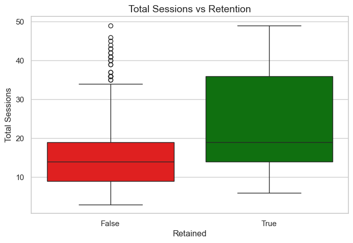
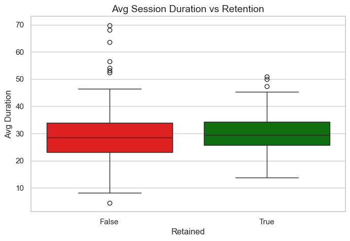
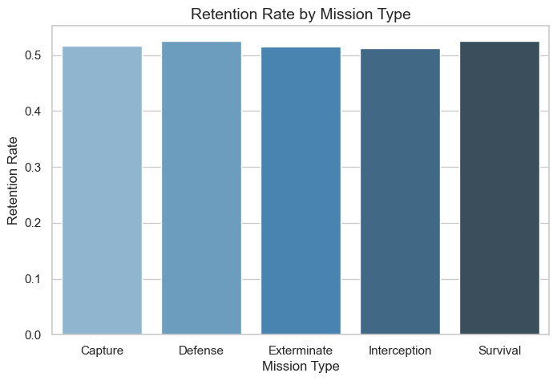

# 🎮 Player Behavior & Retention Analysis

## 🎯 Project Overview

This project analyzes simulated player behavior data to identify key
factors influencing player retention in a game environment.\
The analysis focuses on session activity, engagement patterns, and
mission interactions, with the goal of uncovering actionable insights to
improve player retention.

------------------------------------------------------------------------

## 📊 Dataset

The dataset is synthetically generated and consists of three tables:

-   **Players**: Player demographics (signup date, region, platform)
-   **Sessions**: Player login activity and session duration
-   **Missions**: In-game mission data (type, success, rewards)

------------------------------------------------------------------------

## 🛠 Tools Used

-   Python (pandas, numpy)
-   Data Visualization (matplotlib, seaborn)
-   Jupyter Notebook
-   Data Simulation

------------------------------------------------------------------------

## 📈 Analysis Performed

### 1. Retention Analysis

-   Calculated **Day 1 retention rate (\~40%)**
-   Identified returning users based on login behavior

------------------------------------------------------------------------

### 2. Player Behavior Analysis

-   Compared retained vs non-retained players
-   Analyzed:
    -   Total session count
    -   Average session duration

📌 **Key Result**: - Retained players have significantly higher session
counts\
- Session duration shows only a minor difference

------------------------------------------------------------------------

### 3. Visualization

#### 🔹 Sessions vs Retention

-   Clear separation between retained and non-retained users\
-   Higher engagement frequency strongly correlates with retention

#### 🔹 Duration vs Retention

-   Slight difference in session duration\
-   Not a strong predictor of retention

------------------------------------------------------------------------

### 4. Mission Analysis

-   Compared retention rates across different mission types\
-   Found minimal variation between mission categories

📌 **Key Result**: - Mission type alone is not a strong driver of
retention

------------------------------------------------------------------------

## 📊 Key Findings

-   Retained players have significantly higher session counts than
    non-retained players\
-   Session duration has a weaker impact on retention compared to
    session frequency\
-   Retention rates are consistent across mission types\
-   Early engagement frequency is the strongest indicator of player
    retention

------------------------------------------------------------------------

## 💡 Recommendations

-   Encourage early-stage engagement through onboarding missions\
-   Introduce incentives to increase login frequency (e.g., daily
    rewards)\
-   Focus on increasing session frequency rather than only session
    duration\
-   Prioritize engagement loops over mission-specific design

------------------------------------------------------------------------

## 📈 Visualization

### Sessions vs Retention


- Retained players show significantly higher session counts, indicating stronger engagement frequency.

------------------------------------------------------------------------

### Duration vs Retention


- Session duration shows only minor differences, suggesting it is not a primary driver of retention.

------------------------------------------------------------------------

### Retention by Mission Type


- Mission type alone does not appear to be a strong driver of retention in this simulated dataset.

------------------------------------------------------------------------

## 📌 Conclusion

This analysis demonstrates that **player retention is primarily driven
by engagement frequency**, rather than session duration or mission
type.\
Design strategies that encourage players to return frequently are likely
to have the greatest impact on retention.

------------------------------------------------------------------------

## 📂 Project Structure

```text
WF-PBanalytics-proj/
├── data/          # Generated datasets
├── notebooks/     # Analysis notebook
├── dashboard/     # Saved visualizations
├── sql/           # Optional SQL queries
└── README.md

------------------------------------------------------------------------

## 🚀 Future Improvements

-   Analyze retention over longer time windows (Day 7, Day 30)
-   Incorporate player segmentation (region, platform)
-   Explore mission difficulty and success rate impact
-   Use real-world datasets for validation
